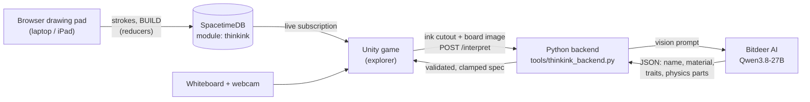

# ThinkInk

**Draw it. The AI decides what it is. Your partner uses it.**

ThinkInk is a two-player co-op puzzle game made at Cal Hacks 2026. One player draws; the other plays. The drawing
becomes a solid paper cutout in a Paper Mario-style side-view world. AI reads what the drawing *is* and gives it real
properties: food feeds the gatekeeper, a rocket really flies, and a trampoline bounces.

> **Your lines decide its shape; AI decides what it is.**

## The game

- **Player A, the inventor,** draws in a browser drawing pad (laptop or iPad) or on a real whiteboard in front of a
  webcam, and presses **BUILD**.
- **Player B, the explorer,** walks, jumps and rides through the level, and asks A for help when they're stuck.
- **What you see is what you stand on.** A drawing is solid only where there's ink. A bridge with a break in it drops
  you into the gap. There are no hidden colliders.
- **Puzzles check traits, not names.** The gatekeeper opens for anything `edible`, so an apple, a pizza and a banana
  all work. That's how a few attributes add up to endless solutions, the way Scribblenauts works.

### The demo route (`Assets/Scenes/Level.unity`)
1. **The gap:** whatever you draw is stretched across it as a bridge, solid only where it's inked.
2. **The gatekeeper:** give them something they can't eat and they cut it up. Give them food and the gate opens.
3. **The launch deck:** the finish ledge is too high for any step plus a jump. Draw a rocket, press E to ride it up,
   and hop off at the flag.

Along the way, drawings of creatures come alive (a cat wanders, a frog hops, a bird flies), and springs, cars and
rockets all work as you'd expect.

## How it works



1. **Capture.** Strokes from the drawing pad sync through SpacetimeDB. Unity redraws them onto a clean board, or reads
   a webcam frame of a real whiteboard, and cuts the ink out.
2. **Shape.** The cutout becomes a flat paper sprite. Its collider is rebuilt from the ink silhouette as thin columns
   accurate to the pixel, extruded into the scene so it can be stood on at any depth.
3. **Meaning.** The board image goes to `POST /interpret`. Bitdeer's vision model says what the drawing is and how it
   behaves.
4. **Behaviour.** Unity applies the attributes: surface traits (bouncy, slippery, sticky), powered parts (bounce,
   thrust, lift; E to ride or fire), creature motion, and the puzzle checks (`edible`, `hostile`, `glows`).

## How we use Bitdeer AI

Bitdeer AI's hosted **Qwen3.8-27B** vision model is the game's understanding of drawings. Every BUILD is one call.

- **What it returns.** The model doesn't return a label: it returns a **game object** as JSON. That means a specific
  name, a material, a weight, up to 8 traits (`edible`, `glows`, `hot`, `bouncy`, ...) and up to 5 physics
  components (support, bounce, thrust, lift, ...), each anchored to a point on the drawing. It also returns a size in
  metres and a friendly line for the player. The contract is in [`docs/interpret-contract.md`](docs/interpret-contract.md).
- **Prompt engineering.** Early on, the model called almost everything a "bridge" because it read the puzzle's goal
  first. The prompt ([`tools/thinkink_system_prompt.txt`](tools/thinkink_system_prompt.txt), with the reasoning in
  [`docs/interpret-prompt.md`](docs/interpret-prompt.md)) makes it work in four steps:
  1. describe the strokes;
  2. name the most specific everyday noun;
  3. give the real thing's attributes;
  4. look at the goal, and only to break a tie between two readings.
  Varied few-shot examples (a duck, a pizza, a cactus, a lightbulb) keep it from copying a vehicle every time.
- **Fast enough to play.**
  - The empty board is cropped and the image is resized before sending.
  - JSON mode is on and Qwen's thinking is off.
  - The backend retries once, within a 30-second budget.
  - An LRU cache answers repeated drawings instantly.
- **Safe by construction.** The backend validates the reply against the vocabulary and clamps every number, and Unity
  clamps it all again. In demo mode, powers are snapped to strengths we tested, so nothing the model says can break
  the physics. The API key lives only in the backend and never reaches the game client.
- **Graceful failure.** A drawing the model can't read still becomes a solid support in its drawn shape. A failed call
  says "Couldn't read that drawing" and keeps the drawing, so it can be retried.

## How we use SpacetimeDB

SpacetimeDB is the real-time link between the person drawing and the game. The server module is
[`server/spacetimedb/src/index.ts`](server/spacetimedb/src/index.ts) (TypeScript). Unity uses the generated C# SDK
bindings, and the browser pad uses the HTTP API.

- **Shared state, not messages.**
  - Rooms with 4-letter codes, players and their roles.
  - Live `drawing_stroke` rows and webcam `board_frame` snapshots.
  - `invention` rows for each BUILD.
  - Per-room `game_state`.

  Clients subscribe to their room; there is no custom network code.
- **BUILD is a transaction.** The pad's BUILD inserts an `invention` row. Unity's subscription sees it, runs the AI
  read and builds it. Up to 8 BUILDs queue in order, and each one keeps its own snapshot of the strokes.
- **Rules live next to the data.**
  - Roles come from the caller's identity, never from arguments: only the creator can draw or publish, and only the
    explorer can spend Ink or change an invention's state.
  - Each invention moves `pending → ready → spawned ⇄ activated` (or `failed`), once per room and capture, so a
    reconnect never duplicates a build.
  - Ink costs are clamped on the server.
  - Payload limits are enforced per reducer.
- **Reset propagates.** `reset_level` clears the room's strokes, frames and inventions and bumps
  `game_state.reset_count`. Every client watches that and resets itself.
- **Local or cloud.** Entering Play mode starts a local SpacetimeDB 2.13.0 server (`tools/start-local-board.ps1`), so
  the demo needs no internet for sync. The same module publishes to Maincloud for two players on two machines, gated
  by a shared sync key kept in a private table.

## Running it

Requires Unity **6000.3.18f1** (Windows), Python 3, and Node.js (only to publish the local SpacetimeDB module the first
time).

1. **Recognition backend** (port 8000):
   ```sh
   BITDEER_API_KEY=... python tools/thinkink_backend.py
   # No key or no internet: answer each BUILD from a script instead (wiring only, no real recognition)
   THINKINK_FAKE=1 THINKINK_FAKE_SEQUENCE=bridge,bridge,apple,rocket python tools/thinkink_backend.py
   ```
2. **Unity:** open the project and `Assets/Scenes/Level.unity`, and press Play. The local SpacetimeDB server starts by
   itself.
3. **Drawing pad:** press **F4**, then **Create room + open drawing pad**. A browser tab opens and the game joins its
   room. Draw, then press BUILD on the page.
4. **Drawing pad on an iPad or phone (optional):** with Play mode running, run
   `powershell -NoProfile -ExecutionPolicy Bypass -File tools/start-ipad-tunnel.ps1`. It needs
   [cloudflared](https://developers.cloudflare.com/cloudflare-one/connections/connect-networks/downloads/)
   (`winget install --id Cloudflare.cloudflared`). It puts the local server and the pad behind two Cloudflare quick
   tunnels, so it works even on networks that block devices from reaching each other, and opens a QR code for the
   iPad. Then join the iPad's room code from F4 in Unity.

More detail: [`docs/README.md`](docs/README.md) (start here), [`docs/coop-spacetimedb.md`](docs/coop-spacetimedb.md)
(rooms, two-machine co-op, tablets) and [`docs/DEERAI-SETUP.md`](docs/DEERAI-SETUP.md) (backend).

### Controls
| Key | Action |
|---|---|
| A / D, W / S | Walk left/right, and away from/toward the camera |
| Space | Jump (or jump off a ride) |
| E | Use or board the nearest drawing (fire a rocket, start a car) |
| Enter | BUILD from the game's side; dismisses the drawing card |
| M | Switch between the drawing pad and the whiteboard webcam |
| G | Toggle the build-placement outline |
| F5 | Reset the level (also clears the drawing pad) |
| F3 / F4 | Debug overlay (shows the AI provider and latency) / co-op panel |

### Tests
- Backend: `python -m unittest discover -s tools -p 'test_thinkink_backend.py'` (no network calls).
- Unity: EditMode tests in `Assets/Scripts/Tests/EditMode/` (Test Runner, or `unity command test run --mode EditMode`).

## Repo map

| Path | What |
|---|---|
| `Assets/Scripts/Core/` | Run flow: BUILD, placement, checkpoints, reset, win |
| `Assets/Scripts/Inventions/` | Drawings as objects: silhouette colliders, attributes, powered parts, creatures |
| `Assets/Scripts/Sockets/` | Puzzles: the gap and the gatekeeper |
| `Assets/Scripts/Vision/` | Webcam capture, ink extraction, the `/interpret` client |
| `Assets/Scripts/Multiplayer/` | SpacetimeDB session, drawing-pad input, co-op HUD (bindings are generated) |
| `server/spacetimedb/` | The SpacetimeDB module |
| `tools/thinkink_backend.py` | The Bitdeer `/interpret` backend |
| `tools/whiteboard/index.html` | The browser drawing pad |
| `docs/` | Design, contracts and handoffs |

## What's next
An Ink budget with pickups (the server already prices and charges inventions), more trait interactions (`hot` +
`flammable` burns, `wet` puts out fire, `floats` crosses water), and an approve screen where the inventor positions
the drawing before it lands.
